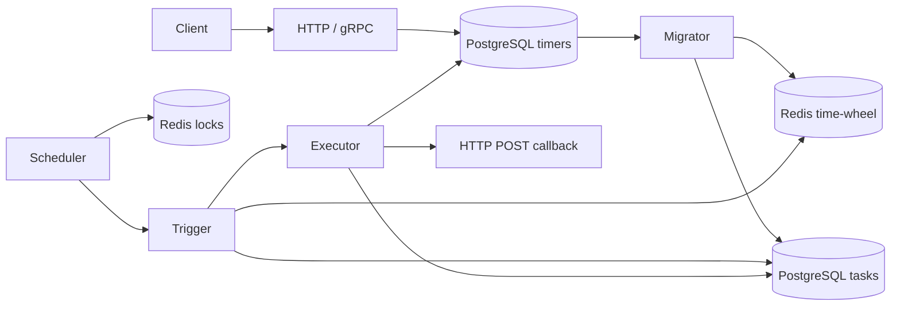

# Architecture

The runtime uses explicit constructor injection. `internal/app` loads and validates
config, opens PostgreSQL/Redis, migrates schemas, builds the components, binds
listeners, and manages cancellation. The CLI entry point only handles flags,
logging, signals and exit status. No runtime configuration/client singleton exists.

## Materialization

The migrator scans enabled timers immediately at startup and every minute. Each
scan obtains a Redis lease for that minute and plans occurrences within twice
`migrate_step_minutes` (ten minutes by default). Calendar cron uses its next
calendar occurrence; constant-delay descriptors derive their phase from the
timer's creation timestamp. A zero next occurrence ends generation, and the
generation loop checks cancellation and caps each timer at 10,000 occurrences.

Tasks have a PostgreSQL unique constraint on `(timer_id, run_timer)`. Repeated
planning uses `ON CONFLICT DO NOTHING`, preserving completed task state.
Redis sorted sets index execution keys by Unix-millisecond score, partitioned by
minute and `timer_id % bucket_num`; TTL removes old indexes.

## Scanning and execution

Once per second, the scheduler tries Redis locks for the current and previous
minute's buckets. Acquired buckets run concurrently; the scheduler joins workers
on cancellation. Triggers perform immediate catch-up, then poll only due ranges.
They reconcile Redis results against durable PostgreSQL pending records in the
same range and bucket, recovering empty or partial Redis indexes. This adds
PostgreSQL range queries even when Redis is healthy.

The executor loads the durable task and timer, verifies pending/enabled state,
and atomically claims the task (`0 → 3`). Only the claim owner calls the endpoint.
The POST honors context and a ten-second timeout; the response is capped at 1 MiB.
A three-second cleanup context allows cancellation results to be saved even
after the worker context is canceled. Terminal state is success (`1`) or failure
(`2`). Callback latency is recorded in Prometheus.

## Boundaries

PostgreSQL is authoritative; Redis is coordination and an index. Task claims avoid
concurrent duplicate sends but cannot atomically commit an external HTTP side
effect with a database result. A process crash or result-write failure can leave
a task running. Reclaim/retry needs a separate idempotency and lease design.

Scheduling scans only the current and previous minute. Extended downtime is not
automatically backfilled. Bucket work processes callbacks sequentially within
each bucket, so slow endpoints reduce capacity. All nodes must share bucket
count and process time zone. Retention and benchmarked capacity are future work.
